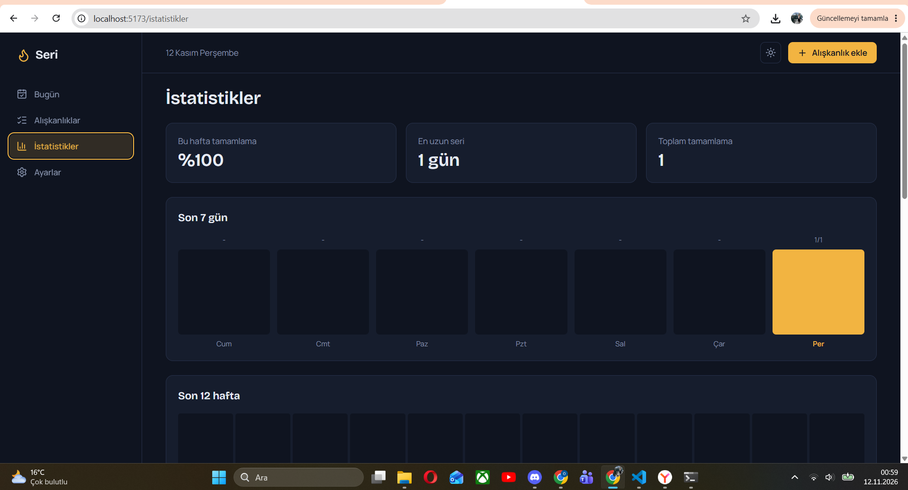

# Habit Tracker (Alışkanlık Takipçisi)

Günlük alışkanlıkları takip etmeni, ilerlemeni görmeni ve rozet kazanmanı sağlayan web uygulaması.



## Özellikler
- Günlük alışkanlık ekleme ve işaretleme
- Bugün sayfasında ilerleme halkası
- Önceki günlere geçip işaretleme
- İstatistikler sayfası ve başarı rozetleri
- Açık/koyu tema
- Ayarlar sayfasında isim kaydı ("Merhaba, isim")
- Örnek veri ekleme
- Veriler tarayıcıda LocalStorage'da saklanır

## Sayfalar
- **Bugün:** günlük ilerleme ve işaretleme
- **Alışkanlıklar:** ekleme, düzenleme, örnek veri
- **İstatistikler:** ilerleme özeti ve rozetler
- **Ayarlar:** isim ve tercihler

## Kullanılan Teknolojiler
- React 19 (Vite ile)
- React Router
- Tailwind CSS 4
- Lucide React (simgeler)
- LocalStorage

## Kurulum
```
git clone https://github.com/Osmanozkan1/habit-tracker.git
cd habit-tracker
npm install
npm run dev
```
Tarayıcıda http://localhost:5173 adresini aç.

## Yapay Zekanın Kullanımı
Bu projede yapay zeka asistanı olarak Claude kullanıldı:
- **Planlama:** Uygulama fikri, sayfalar ve veri modeli birlikte planlandı.
- **Geliştirme:** Bileşenler (ilerleme halkası, rozetler, ayarlar, tema değiştirme) birlikte yazıldı.
- **Hata ayıklama:** Hata mesajları ve beklenmedik davranışlar birlikte çözüldü.
- **Sürüm kontrolü:** Git ve GitHub'a yükleme adımlarında yardım alındı.
- **Doğrulama:** Üretilen kod tarayıcıda elle test edildi.